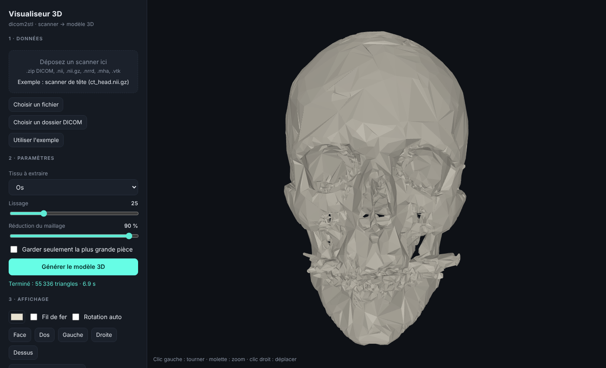

# dicom2stl + visualiseur 3D

Ce projet transforme un **scanner médical** (CT / IRM, au format DICOM, NIfTI, NRRD…) en **modèle 3D**, et l'affiche dans une **interface web** que l'on peut faire tourner et zoomer à la souris.



Le moteur de conversion est le projet open source [dicom2stl](https://github.com/dave3d/dicom2stl) (David T. Chen, licence Apache 2.0). L'interface web (dossier `viewer/`) a été ajoutée par-dessus.

> **Avertissement** : outil de visualisation et de démonstration. Il n'est pas validé pour le diagnostic médical.

## Voir le crâne sans rien installer

Double-cliquez sur **`crane_3d_interactif.html`** : il s'ouvre dans votre navigateur avec un crâne 3D déjà chargé. Vous pouvez le tourner, zoomer, le couper (plans sagittal, coronal, axial), régler la transparence et mesurer une distance en millimètres. Ce fichier contient seulement le crâne d'exemple ; pour vos propres scanners, utilisez l'interface ci-dessous.

## Démarrage rapide

Prérequis : **Python 3.11 ou plus récent** (https://www.python.org/downloads/).

**Windows** : double-cliquez sur `viewer\run.bat`.

**macOS / Linux** :
```bash
bash viewer/run.sh
```

La première fois, le script crée un environnement Python (`venv/`) et installe les dépendances (quelques minutes, environ 300 Mo). Ensuite le navigateur s'ouvre sur **http://127.0.0.1:5000**.

### Lancement manuel (si vous préférez)
```bash
python -m venv venv
# Windows : venv\Scripts\activate      macOS/Linux : source venv/bin/activate
pip install -r requirements.txt
pip install -r viewer/requirements.txt
python viewer/app.py
```

## Utilisation

1. Cliquez sur **Utiliser l'exemple** pour voir tout de suite un crâne (scanner fourni dans `examples/Data/`), ou chargez vos données :
   - un fichier : `.zip` contenant une série DICOM, `.nii`, `.nii.gz`, `.nrrd`, `.mha`, `.vtk`
   - ou **un dossier DICOM** (tous les fichiers `.dcm` d'une même série)
2. Choisissez le **tissu** : Os, Peau, Tissus mous ou Graisse.
3. Cliquez sur **Générer le modèle 3D** (quelques secondes à quelques minutes selon la taille).
4. Dans la vue 3D : clic gauche = tourner, molette = zoom, clic droit = déplacer.
5. Boutons : vues Face / Dos / Gauche / Droite / Dessus, couleur, fil de fer, rotation automatique, **enregistrer l'image PNG**, **télécharger le STL** (pour MeshLab, Blender, impression 3D).

### Régler la qualité
- **Réduction du maillage** : 90 % par défaut (rapide, léger, un peu anguleux). Descendez à 50 % ou moins pour une surface plus fine, au prix d'un fichier plus lourd.
- **Lissage** : plus la valeur est haute, plus la surface est lisse.
- **Garder seulement la plus grande pièce** : supprime les petits fragments isolés (bruit).

## Utiliser seulement la ligne de commande

```bash
python -m dicom2stl.Dicom2STL --type bone --output os.stl chemin/vers/dossier_dicom
```
Types de tissu : `skin`, `bone`, `soft`, `fat`. Aide complète : `python -m dicom2stl.Dicom2STL --help`.

## Tests

```bash
python -m unittest discover -s tests            # moteur dicom2stl (16 tests)
python -m unittest discover -s viewer/tests -v  # interface web (8 tests)
```

## Contenu du projet

| Chemin | Rôle |
|---|---|
| `viewer/app.py` | Serveur web (Flask) : reçoit le scanner, lance dicom2stl, renvoie le STL |
| `viewer/static/index.html` | Page de l'interface (three.js pour l'affichage 3D) |
| `viewer/static/vendor/` | three.js embarqué (licence MIT) : aucun accès internet requis |
| `viewer/run.sh`, `viewer/run.bat` | Lancement en un clic |
| `dicom2stl/` | Moteur de conversion d'origine |
| `examples/Data/ct_head.nii.gz` | Scanner de tête d'exemple |

## Problèmes fréquents

- **« python introuvable »** : installez Python 3.11+ et cochez « Add Python to PATH » sous Windows.
- **L'installation de VTK échoue** : votre version de Python est probablement trop récente ou trop ancienne pour les paquets ; essayez Python 3.12 ou 3.13.
- **Page blanche / vue 3D noire** : votre navigateur doit supporter WebGL (Chrome, Firefox, Edge, Safari récents).
- **Le port 5000 est déjà pris** (fréquent sur macOS) : `python viewer/app.py --port 5050`, puis ouvrez http://127.0.0.1:5050.
- **« Échec de la conversion »** : le détail technique s'affiche sous le bouton. Vérifiez que le dossier contient bien **une seule série** DICOM.
- **Gros scanners** : la réduction du maillage et la conversion peuvent prendre plusieurs minutes et beaucoup de mémoire.

## Confidentialité

Le serveur écoute uniquement sur votre ordinateur (`127.0.0.1`) : vos données médicales ne sont envoyées nulle part. Les fichiers temporaires sont supprimés à l'arrêt du serveur.
